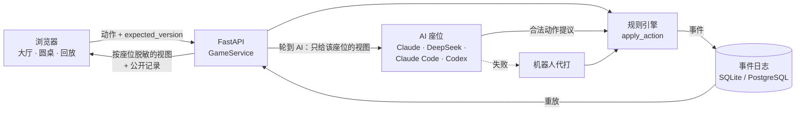

# Avalon AI Game Master

**一个人也能打的阿瓦隆：真人和多个大模型同桌，规则由确定性引擎裁决，AI 只能提出合法动作；每一局都能从头回放，看清每个模型当时看到了什么、想了什么、说了什么。**

React + TypeScript 前端 · FastAPI 后端 · 事件溯源（SQLite / PostgreSQL）· Claude / DeepSeek / 本机 Claude Code / 本机 Codex 四种模型驱动 · 181 个评测用例

## 解决什么问题

| 问题 | 这里的做法 |
| --- | --- |
| 阿瓦隆要 5–12 个人，凑不齐 | 空座由会推理的机器人或大模型补上；也可以只看 AI 互打 |
| 让大模型当裁判不可靠：会被说服、会泄密、同一局面两种裁决 | 规则只在纯 Python 引擎里；模型只拿到自己座位能看到的东西，只能从合法动作里选（[ADR 0001](docs/adr/0001-the-model-never-owns-the-rules.md)） |
| 模型会超时、乱答、被别人的发言带偏 | 结构化输出 + 严格校验 + 一次带原因的重试，再不行由机器人代打，界面上标出来（[ADR 0003](docs/adr/0003-least-privilege-agents-with-a-fallback.md)） |
| AI 为什么这么打，事后看不见 | 只存事件，状态靠重放；每个模型回合的输入、回答、被拒原因都存下来，回放时逐步展示（[ADR 0002](docs/adr/0002-an-event-log-for-replay-and-concurrency.md)） |

## 能做什么

| 功能 | 说明 |
| --- | --- |
| 单人对局 | 你和 4–11 个 AI 同桌，圆桌界面，提名 → 轮流发言 → 投票 → 任务 → 刺杀 |
| 每个座位选模型 | 内置机器人、Claude（API）、DeepSeek（API）、本机 Claude Code、本机 Codex；12 个有性格的角色 |
| 观战 | 全部座位由 AI 打，你看到所有身份和每个 AI 的“心声” |
| 回放 | 结束的对局从发牌开始重放，可暂停、单步、拖进度、调速；每一步下面是背后的模型回合 |
| 5–12 人 | 官方 5–10 人规则，加自定的 11–12 人扩展规则 |
| AI 主持 | 事实句来自模板，模型只配语气和一句氛围话，对局中不许提角色名 |
| 朗读 | 浏览器自带的语音念出每句发言，每个角色音高语速不同 |

## 关键数字

所有数字的来源和复现命令见 [`docs/evidence/resume-metrics.md`](docs/evidence/resume-metrics.md)。

| 指标 | 数值 |
| --- | --- |
| 测试 | 后端 850 个（覆盖率 98%），前端 125 个；CI 约 3 分钟 |
| 故意捣乱的替身模型，141 个回合 | 最终动作 100% 合法，发给模型的秘密 0 |
| 本机 Codex，149 个玩家用例 | 最终动作 100% 合法，首答 98.7% 合法，越权 0%，发言注入 8/8 没被带偏，P50 6.6 秒 |
| 本机 Codex，32 个主持用例 | 事实句、规则提示、角色名三项检查 100% 通过 |
| 机器人互打，好人胜率 | 5–12 人 10%–41%（邪恶方偏强，见评测文档） |

还没有的：在线 Demo（部署暂缓）、真人试玩反馈、Claude / DeepSeek 的实测数字（需要付费密钥）、多人联机。

## 架构



完整的数据流和信任边界见 [`docs/architecture.md`](docs/architecture.md) 第 0 节；威胁和对策见 [`docs/threat-model.md`](docs/threat-model.md)。

## 从这里开始

1. 按下面的“本地运行”把后端和前端跑起来，打开 <http://localhost:5173>，选“观战”看一局 AI 互打，结束后点“从头回放”。
2. 读 [`docs/adr/`](docs/adr/README.md) 里的三篇设计决策。
3. 版本历史见 [`CHANGELOG.md`](CHANGELOG.md)，后续计划见 [`docs/roadmap.md`](docs/roadmap.md)。

## 本地运行

后端（Python 3.12）。用 `py -3.12` 而不是 `python` 建环境：机器上同时装着别的 Python 版本时，`python` 不一定指向 3.12。

```powershell
cd apps/api
py -3.12 -m venv .venv
.\.venv\Scripts\python.exe -m pip install -e ".[dev]"
.\.venv\Scripts\python.exe -m ruff check .
.\.venv\Scripts\python.exe -m pytest
.\.venv\Scripts\python.exe -m uvicorn app.main:app --reload --port 8000
```

前端（Node 22 或 24 均可，CI 和容器用 24；pnpm 由 Node 自带的 corepack 提供，不用单独安装）：

```powershell
cd apps/web
corepack pnpm install
corepack pnpm test
corepack pnpm dev
```

每一局都会完整保存在 `apps/api/data/avalon.db`（SQLite，启动时自动建表，已被 git 忽略），重启后端不会丢。保存的内容足够以后回放：所有事件（含发牌、每张选票和任务牌）、公开记录、每个 AI 的心声，以及每个模型回合看到了什么、回答了什么、用了多久。导出某一局：

```powershell
cd apps/api
.\.venv\Scripts\python.exe -m app.records            # 列出所有对局
.\.venv\Scripts\python.exe -m app.records <game_id>  # 写到 records/<game_id>.json
```

想换成 PostgreSQL 就设置 `DATABASE_URL`（写法见 [`docs/database.md`](docs/database.md)）；设成 `memory` 则只放在内存里，重启即丢。

想让 AI 上桌，每个座位可以单独选由谁来打。三种来源，配好哪个，大厅里就能选哪个：

| 来源 | 需要什么 | 花费 |
| --- | --- | --- |
| Claude（API） | `ANTHROPIC_API_KEY` | 每个回合一次付费调用 |
| DeepSeek（API） | `DEEPSEEK_API_KEY` | 每个回合一次付费调用 |
| 本机 Claude Code | 装好 Claude Code 并登录一次（终端运行 `claude`），不要密钥 | 用你自己的订阅额度，每步十几秒到一两分钟 |
| 本机 Codex | 装好 Codex（桌面版或命令行）并用 ChatGPT 登录一次，不要密钥 | 用你的 ChatGPT 额度，每步几秒到半分钟 |

密钥写进 `apps/api/.env`（照 [`apps/api/.env.example`](apps/api/.env.example) 复制一份，已被 git 忽略），重启后端生效。每局有 token 上限（默认 30 万，`LLM_MAX_TOKENS_PER_GAME`）；全部配置项见 [`docs/architecture.md`](docs/architecture.md) 第 5.1 节。AI 主持只用 API（Claude 或 DeepSeek），本机客户端太慢，不用来主持。

也可以只看不打：大厅里选“观战”，所有座位都由 AI 来打，你能看到每个人的身份和“心声”（每个 AI 做决定时的真实想法）；上桌打的对局结束后，也能在复盘里看到所有心声。

每一局结束后都能**从头回放**：大厅的“最近的对局”列出这个浏览器打过的局，回放时全部身份可见，可以暂停、单步、拖进度、调速，每一步下面列出背后的模型回合——模型看到了什么、回答了什么、被规则拒绝的原因、耗时和 token。浏览器支持时可以打开“朗读”，用浏览器自带的声音念出每一句话（每个角色音高、语速不同）。

先按上面启动后端，再打开 <http://localhost:5173>：输入昵称、选人数、创建对局，就可以和机器人打一局。对局是一张圆桌：队长选人后，从队长开始每人发言一次（可以点名你怀疑的人），然后全体投票；机器人会根据任务结果、投票和点名判断谁可疑，并说出理由。页面请求 `/api/...`，由 Vite 代理转发到后端；后端不在 `http://127.0.0.1:8000` 时用环境变量 `API_PROXY_TARGET` 指定。

整套环境（Docker Compose，含 PostgreSQL）：

```powershell
Copy-Item .env.example .env
docker compose up --build --wait
```

同样打开 <http://localhost:5173>，看到“服务在线”即三个容器都正常。API 容器启动时会自动执行数据库迁移，对局存在 `postgres-data` 卷里。

在终端看一局随机对局（同样的参数永远是同一局）：

```powershell
cd apps/api
.\.venv\Scripts\python.exe -m app.game.simulate --players 7 --seed 42
```

## 评测

181 个固定用例（玩家决策 149、主持 32）加整局对比，全部可以不花钱地跑一遍来检查管线：

```powershell
cd apps/api
.\.venv\Scripts\python.exe -m app.evals.run --provider hostile --out eval-out
```

| 实测数字（2026-11-22） | 值 |
| --- | --- |
| 随机 bot 对随机 bot，好人胜率（每种人数 500 局） | 5 人 11.6%，6 人 11.6%，7 人 9.6%，8 人 7.2%，9 人 11.6%，10 人 8.4% |
| 会推理的机器人互打，好人胜率（每种人数 500 局） | 5 人 35.6%，6 人 24.6%，7 人 13.8%，8 人 14.4%，9 人 20.6%，10 人 16.6% |
| 故意捣乱的替身模型，141 个回合里最终动作合法 | 141 / 141（其中 65.2% 靠回退） |
| 同一次运行里发给模型的秘密 | 0 |
| 本机 Codex：149 个玩家用例最终动作合法 / 首答合法 / 越权 | 100% / 98.7% / 0%（`--provider codex`，用 ChatGPT 额度） |
| Claude、DeepSeek 的合法率、延迟、成本、胜率 | 还没跑，需要付费密钥 |

怎么读这些数字、用例怎么来的、哪些没覆盖，见 [`docs/evidence/agent-evaluation.md`](docs/evidence/agent-evaluation.md)。

后端日志是每行一个 JSON 对象，带 `request_id`、`game_id`、`event_id`；想在终端里读纯文本就设 `LOG_FORMAT=text`。

## 文档

| 文档 | 用途 |
| --- | --- |
| [`docs/roadmap.md`](docs/roadmap.md) | 版本顺序、范围、验收标准；顺序和范围以它为准 |
| [`docs/architecture.md`](docs/architecture.md) | 数据流总览、规则引擎、前后端模块、状态图、接口、可见性规则、回放 |
| [`docs/adr/`](docs/adr/README.md) | 三篇设计决策记录：模型不拥有规则、事件日志、AI 最小权限与回退 |
| [`docs/evidence/resume-metrics.md`](docs/evidence/resume-metrics.md) | 每个对外数字的来源和复现命令，以及哪些不能说 |
| [`CHANGELOG.md`](CHANGELOG.md) | 每个版本做了什么 |
| [`docs/database.md`](docs/database.md) | 表结构、ER 图、事件追加的事务与乐观并发、五条查询 |
| [`docs/threat-model.md`](docs/threat-model.md) | AI 玩家和 AI 主持的信任边界、威胁、对策和对应测试 |
| [`docs/evidence/agent-evaluation.md`](docs/evidence/agent-evaluation.md) | 评测用例、指标定义、基线数字、失败样例、人工标注方法 |
| [`docs/superpowers/plans/2026-09-15-avalon-ai-game-master.md`](docs/superpowers/plans/2026-09-15-avalon-ai-game-master.md) | 每个 Task 的详细步骤、接口和 AI 等级 |
| [`docs/getting-started.md`](docs/getting-started.md) | AI 五等级规则、目录结构、文件职责 |
| [`docs/learning-log.md`](docs/learning-log.md) | 每个切片的本人复盘 |

