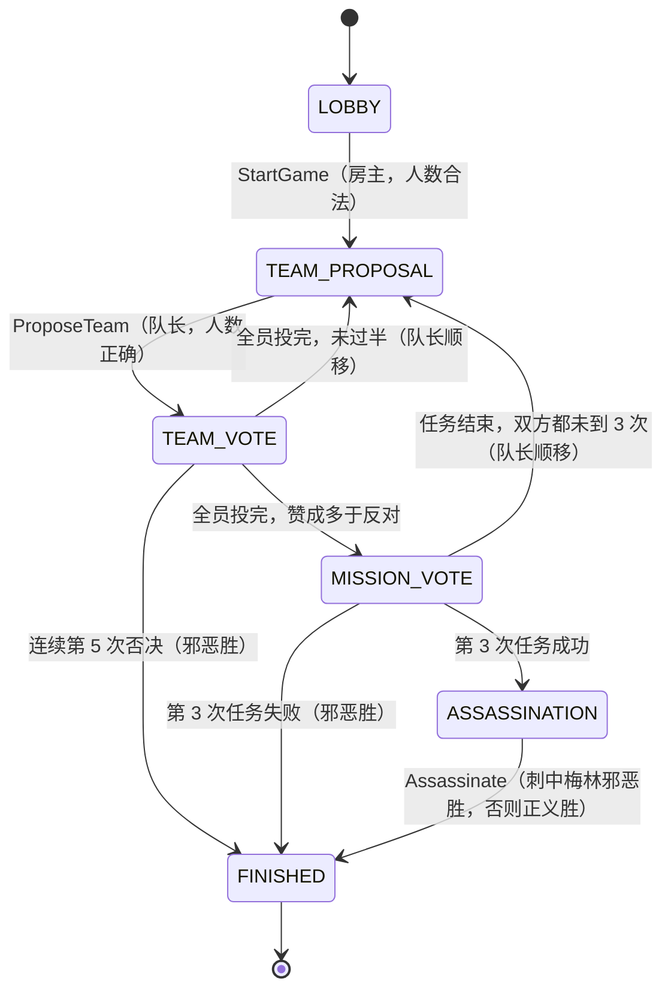

# 架构

目前有规则引擎（v0.2）和单人对局的前后端（v0.3）。持久化、联机和 AI 接入后在这里补充。

## 1. 规则引擎

位置：`apps/api/app/game/`。它是游戏状态转换的唯一权威，只依赖 Python 标准库。

| 模块 | 职责 |
| --- | --- |
| `rulesets.py` | 规则配置：人数、阵营、任务队伍人数、失败阈值、角色牌组、胜负条件 |
| `state.py` | 不可变的 `GameState` / `PlayerState` / `MissionState` |
| `actions.py` | 玩家提交的命令：`StartGame`、`ProposeTeam`、`VoteTeam`、`VoteMission`、`Assassinate` |
| `events.py` | 已经发生的事实，状态只能通过事件改变 |
| `errors.py` | `RuleViolation` 和稳定的错误码 |
| `engine.py` | `new_game`、`apply_action`、`evolve`、`replay` |
| `simulate.py` | 用随机合法动作跑完一局并打印，开发工具 |

### 1.1 两个核心函数

```text
apply_action(state, action) -> (new_state, events)   校验 + 决定发生了什么
evolve(state, event)        -> new_state             应用一个事件，不做校验
```

- `apply_action` 先校验动作；不合法就抛 `RuleViolation`，状态不变。合法则产生一串事件，并用 `evolve` 逐个应用。
- 状态只经由 `evolve` 改变，所以把一局的事件按顺序重新应用（`replay`），一定得到同一个状态。v0.4 的数据库只需要保存事件。
- 每个事件让 `state.version` 加 1。动作可以带 `expected_version`，与当前版本不符时拒绝，避免玩家对着过期画面操作。
- 唯一的随机来源是 `StartGame.seed`，它决定发牌和首任队长。种子由服务端生成，不能由客户端指定。

### 1.2 状态图



规则集关闭刺杀时，第 3 次任务成功直接进入 `FINISHED`（正义胜）。

### 1.3 动作、校验和事件

| 动作 | 所需阶段 | 校验（错误码） | 产生的事件 |
| --- | --- | --- | --- |
| `StartGame` | `LOBBY` | `not_host`、`invalid_player_count` | `GameStarted`、`MissionStarted` |
| `ProposeTeam` | `TEAM_PROPOSAL` | `not_leader`、`duplicate_team_member`、`unknown_team_member`、`wrong_team_size` | `TeamProposed` |
| `VoteTeam` | `TEAM_VOTE` | `already_voted` | `TeamVoteCast`；全员投完后 `TeamApproved`，或 `TeamRejected`（第 5 次再加 `GameFinished`） |
| `VoteMission` | `MISSION_VOTE` | `not_on_team`、`already_voted`、`good_must_succeed` | `MissionVoteCast`；全队出完后 `MissionCompleted`，再加 `MissionStarted` / `AssassinationStarted` / `GameFinished` 之一 |
| `Assassinate` | `ASSASSINATION` | `not_assassin`、`invalid_target` | `AssassinationAttempted`、`GameFinished` |

所有动作共有的校验：`stale_version`（版本过期）、`unknown_player`（不在本局）、`wrong_phase`（阶段不对）。

几条容易记错的规则：

- 组队投票平票算否决，必须赞成票严格多于反对票。
- 队长在每次否决后、每个任务结束后各顺移一位。
- 连续否决次数在新任务开始时清零。
- 正义方在任务中只能出成功牌；邪恶方两种都可以出。
- 刺客可以指认除自己以外的任何人。不限制为“正义方玩家”，否则合法目标列表会泄露身份。

### 1.4 规则集

引擎不写死任何数字，全部读自 `RuleSet`：

| 字段 | 含义 |
| --- | --- |
| `tables[人数]` | `good_count`、`evil_count`、`team_sizes`、`fail_thresholds`、`roles` |
| `min_players` / `max_players` | 由 `tables` 的人数范围得出 |
| `assassination_enabled` | 三次成功后是否进入刺杀 |
| `missions_to_win` | 赢下几次任务获胜，默认 3 |
| `max_rejected_proposals` | 连续否决几次邪恶方获胜，默认 5 |

`RuleSet` 创建时会自检：人数连续、阵营人数与牌组一致、任务数等于 `2 × missions_to_win − 1`、失败阈值不超过队伍人数和邪恶人数、启用刺杀时牌组里恰好有一个梅林和一个刺客。

目前只有一套规则 `official`，数据来自《The Resistance: Avalon》规则书的人数表和任务表：

| 人数 | 正义 | 邪恶 | 各任务队伍人数 | 各任务所需失败票 |
| ---: | ---: | ---: | --- | --- |
| 5 | 3 | 2 | 2, 3, 2, 3, 3 | 1, 1, 1, 1, 1 |
| 6 | 4 | 2 | 2, 3, 4, 3, 4 | 1, 1, 1, 1, 1 |
| 7 | 4 | 3 | 2, 3, 3, 4, 4 | 1, 1, 1, 2, 1 |
| 8 | 5 | 3 | 3, 4, 4, 5, 5 | 1, 1, 1, 2, 1 |
| 9 | 6 | 3 | 3, 4, 4, 5, 5 | 1, 1, 1, 2, 1 |
| 10 | 6 | 4 | 3, 4, 4, 5, 5 | 1, 1, 1, 2, 1 |

默认牌组是梅林、刺客，其余为忠臣和爪牙。派西维尔、莫甘娜、莫德雷德、奥伯伦已定义为角色，可以放进自定义牌组，但它们的“谁能看见谁”属于视图层，v0.3 及以后才实现。

### 1.5 保密

`GameState` 和事件日志都包含秘密：角色分配、每个人在任务中出的牌。它们不能直接发给客户端或模型。v0.3 的 `views.py` 负责按玩家生成脱敏视图，那是秘密信息的唯一出口。

### 1.6 测试如何保证正确

| 测试 | 内容 |
| --- | --- |
| `test_rulesets.py` | 5–10 人官方表逐项对照规则书；不自洽的规则集被拒绝 |
| `test_engine.py` | 每个动作的每条校验、每个阶段转换、五种结局 |
| `test_properties.py` | 任意动作序列（含非法动作和局外人）都不破坏不变量，且对局一定结束；同一种子重放得到相同事件和状态 |
| `test_simulate.py` | 终端模拟器输出稳定 |
| `test_boundaries.py` | `app/game` 只导入标准库和自身 |

不变量集中写在 `tests/game/invariants.py`，例如：任何一方的任务数不超过获胜所需、始终只有一个队长且是在座玩家、已完成的任务是前缀、阶段与待决投票一致、结局与原因吻合。

### 1.7 在终端看一局

```powershell
cd apps/api
.\.venv\Scripts\python.exe -m app.game.simulate --players 7 --seed 42
```

同样的参数永远打印同一局。这是开发工具：它读取完整的秘密状态来决定谁可以出失败牌，不是 AI 玩家。

## 2. 单人对局后端

一名真人坐庄，其余席位由 bot 补满。数据都在进程内存里，重启即丢，v0.4 换成 PostgreSQL。

```text
浏览器 ──HTTP──> api/rooms.py, api/games.py      协议：鉴权、请求转动作、视图转响应
                        │
                        v
                   service.py                    一条命令路径：真人和 bot 都走这里
                    │      │
        apply_action│      │choose_action(view)
                    v      v
             game/engine   agents/policy_fallback   bot 只拿到自己席位的视图
                    │
                    v
             game/repository（事件日志）   rooms.py（席位、名字、令牌摘要）
```

| 模块 | 职责 |
| --- | --- |
| `game/views.py` | `build_player_view` 和 `legal_actions`；秘密信息的唯一出口 |
| `game/repository.py` | `GameRepository` 接口和内存实现；只追加事件，按版本做乐观并发检查 |
| `agents/policy_fallback.py` | 随机合法 bot，只读取 `PlayerView` |
| `rooms.py` | 房间、席位、重连令牌（只存 SHA-256 摘要） |
| `service.py` | 建房、鉴权、提交动作、推进 bot 回合 |
| `api/` | FastAPI 路由、请求和响应模型、统一错误格式 |

### 2.1 接口

| 方法 | 路径 | 说明 |
| --- | --- | --- |
| `POST` | `/rooms` | 建房并入座。响应里的 `token` 只出现这一次 |
| `GET` | `/games/{game_id}` | 你这个席位能看到的对局 |
| `POST` | `/games/{game_id}/actions` | 提交一个动作；随后 bot 连续行动，直到又需要真人 |

后两个接口需要 `Authorization: Bearer <token>`。错误统一为 `{"code": "...", "message": "..."}`：

| 状态码 | 含义 | 例子 |
| ---: | --- | --- |
| 401 | 没带令牌或令牌无效 | `missing_token`、`invalid_token` |
| 403 | 轮不到你做 | `wrong_game`、`not_leader`、`not_on_team` |
| 404 | 对局不存在（只对已鉴权的请求如实回答） | `game_not_found` |
| 409 | 现在不能做 | `wrong_phase`、`stale_version`、`already_voted` |
| 422 | 内容不对 | `wrong_team_size`、`good_must_succeed`，以及请求体格式错误 |

### 2.2 一次提交发生了什么

1. 令牌换成席位；席位不属于这局则拒绝。
2. 加锁，从仓库读出当前状态，记下版本。
3. `apply_action` 校验并应用真人的动作。
4. 依次找到有合法动作的 bot，给它自己的视图，让它选一个动作，再经 `apply_action` 应用；直到没有 bot 能动。
5. 把这次产生的全部事件按第 2 步的版本一次性追加到仓库。
6. 用最新状态为这名真人生成视图并返回。

bot 的随机数由“房间种子、席位、当前版本”派生，所以同一个种子加同样的真人操作会重现同一局。

### 2.3 谁能看见什么

| 你的角色 | 你知道 |
| --- | --- |
| 梅林 | 哪些人是邪恶方（看不到莫德雷德），不知道具体角色 |
| 派西维尔 | 梅林和莫甘娜是哪两个人，分不清谁是谁 |
| 邪恶方（奥伯伦除外） | 彼此是邪恶方（看不到奥伯伦） |
| 奥伯伦、忠臣 | 什么都不知道 |

所有人始终知道自己的角色。对局结束后公开全部角色。组队投票在全员投完前只公开“谁投了”，不公开投了什么；任务牌永远只公开失败票的数量。

响应由 `PlayerView` 转换而来，从不直接序列化 `GameState`。种子不出现在任何响应里。

## 3. 前端

位置：`apps/web/src/`。React + TypeScript，没有路由库和状态库。

| 模块 | 职责 |
| --- | --- |
| `api/client.ts` | 接口类型和三个请求函数；错误统一成 `ApiError(status, code, message)` |
| `session.ts` | 把 `{gameId, token}` 存在 sessionStorage，刷新页面后能回到对局 |
| `features/game/gameReducer.ts` | 全部 UI 状态：大厅、恢复中、对局中 |
| `features/game/GamePage.tsx` | 对局界面，纯展示组件 |
| `features/game/labels.ts` | 角色、阶段、结局、错误码的中文文案 |
| `features/lobby/LobbyPage.tsx` | 建房表单和服务状态 |
| `App.tsx` | 把 reducer、请求和页面接起来 |
| `styles.css` | “琥珀夜色”设计系统的变量和组件样式 |

几条约束：

- 服务器返回的对局只保存一份（reducer 里的 `game`）。客户端自己的状态只有三样：请求是否在途、上一次的错误、队长选到一半的队伍。
- 界面不推断规则。按钮是否出现完全取决于 `legal_actions`；阶段、胜负、谁是队长都直接读服务器的字段。
- 他人的身份不在客户端：服务器没发，DOM 里就不可能有。对局结束后服务器才发全部身份。
- 每次提交都带上玩家看到的 `version`。服务器返回 409 时，前端重新拉取对局再提示原因。
- 重复点击由 `App.tsx` 里的一个 ref 挡住，按钮同时置灰。
- 字体只写在字体栈里，不从网络加载。
