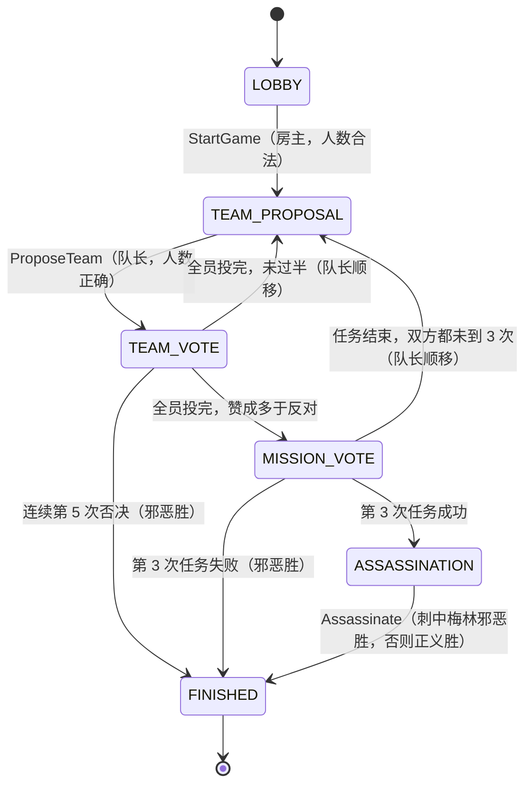

# 架构

目前只有规则引擎（v0.2）。API、持久化、界面和 AI 接入后在这里补充。

## 1. 规则引擎

位置：`apps/api/app/game/`。它是游戏状态转换的唯一权威，只依赖 Python 标准库。

| 模块 | 职责 |
| --- | --- |
| `rulesets.py` | 规则配置：人数、阵营、任务队伍人数、失败阈值、角色牌组、胜负条件 |
| `state.py` | 不可变的 `GameState` / `PlayerState` / `MissionState` |
| `actions.py` | 玩家提交的命令：`StartGame`、`ProposeTeam`、`VoteTeam`、`VoteMission`、`Assassinate` |
| `events.py` | 已经发生的事实，状态只能通过事件改变 |
| `errors.py` | `RuleViolation` 和稳定的错误码 |
| `engine.py` | `new_game`、`apply_action`、`evolve`、`replay` |
| `simulate.py` | 用随机合法动作跑完一局并打印，开发工具 |

### 1.1 两个核心函数

```text
apply_action(state, action) -> (new_state, events)   校验 + 决定发生了什么
evolve(state, event)        -> new_state             应用一个事件，不做校验
```

- `apply_action` 先校验动作；不合法就抛 `RuleViolation`，状态不变。合法则产生一串事件，并用 `evolve` 逐个应用。
- 状态只经由 `evolve` 改变，所以把一局的事件按顺序重新应用（`replay`），一定得到同一个状态。v0.4 的数据库只需要保存事件。
- 每个事件让 `state.version` 加 1。动作可以带 `expected_version`，与当前版本不符时拒绝，避免玩家对着过期画面操作。
- 唯一的随机来源是 `StartGame.seed`，它决定发牌和首任队长。种子由服务端生成，不能由客户端指定。

### 1.2 状态图



规则集关闭刺杀时，第 3 次任务成功直接进入 `FINISHED`（正义胜）。

### 1.3 动作、校验和事件

| 动作 | 所需阶段 | 校验（错误码） | 产生的事件 |
| --- | --- | --- | --- |
| `StartGame` | `LOBBY` | `not_host`、`invalid_player_count` | `GameStarted`、`MissionStarted` |
| `ProposeTeam` | `TEAM_PROPOSAL` | `not_leader`、`duplicate_team_member`、`unknown_team_member`、`wrong_team_size` | `TeamProposed` |
| `VoteTeam` | `TEAM_VOTE` | `already_voted` | `TeamVoteCast`；全员投完后 `TeamApproved`，或 `TeamRejected`（第 5 次再加 `GameFinished`） |
| `VoteMission` | `MISSION_VOTE` | `not_on_team`、`already_voted`、`good_must_succeed` | `MissionVoteCast`；全队出完后 `MissionCompleted`，再加 `MissionStarted` / `AssassinationStarted` / `GameFinished` 之一 |
| `Assassinate` | `ASSASSINATION` | `not_assassin`、`invalid_target` | `AssassinationAttempted`、`GameFinished` |

所有动作共有的校验：`stale_version`（版本过期）、`unknown_player`（不在本局）、`wrong_phase`（阶段不对）。

几条容易记错的规则：

- 组队投票平票算否决，必须赞成票严格多于反对票。
- 队长在每次否决后、每个任务结束后各顺移一位。
- 连续否决次数在新任务开始时清零。
- 正义方在任务中只能出成功牌；邪恶方两种都可以出。
- 刺客可以指认除自己以外的任何人。不限制为“正义方玩家”，否则合法目标列表会泄露身份。

### 1.4 规则集

引擎不写死任何数字，全部读自 `RuleSet`：

| 字段 | 含义 |
| --- | --- |
| `tables[人数]` | `good_count`、`evil_count`、`team_sizes`、`fail_thresholds`、`roles` |
| `min_players` / `max_players` | 由 `tables` 的人数范围得出 |
| `assassination_enabled` | 三次成功后是否进入刺杀 |
| `missions_to_win` | 赢下几次任务获胜，默认 3 |
| `max_rejected_proposals` | 连续否决几次邪恶方获胜，默认 5 |

`RuleSet` 创建时会自检：人数连续、阵营人数与牌组一致、任务数等于 `2 × missions_to_win − 1`、失败阈值不超过队伍人数和邪恶人数、启用刺杀时牌组里恰好有一个梅林和一个刺客。

目前只有一套规则 `official`，数据来自《The Resistance: Avalon》规则书的人数表和任务表：

| 人数 | 正义 | 邪恶 | 各任务队伍人数 | 各任务所需失败票 |
| ---: | ---: | ---: | --- | --- |
| 5 | 3 | 2 | 2, 3, 2, 3, 3 | 1, 1, 1, 1, 1 |
| 6 | 4 | 2 | 2, 3, 4, 3, 4 | 1, 1, 1, 1, 1 |
| 7 | 4 | 3 | 2, 3, 3, 4, 4 | 1, 1, 1, 2, 1 |
| 8 | 5 | 3 | 3, 4, 4, 5, 5 | 1, 1, 1, 2, 1 |
| 9 | 6 | 3 | 3, 4, 4, 5, 5 | 1, 1, 1, 2, 1 |
| 10 | 6 | 4 | 3, 4, 4, 5, 5 | 1, 1, 1, 2, 1 |

默认牌组是梅林、刺客，其余为忠臣和爪牙。派西维尔、莫甘娜、莫德雷德、奥伯伦已定义为角色，可以放进自定义牌组，但它们的“谁能看见谁”属于视图层，v0.3 及以后才实现。

### 1.5 保密

`GameState` 和事件日志都包含秘密：角色分配、每个人在任务中出的牌。它们不能直接发给客户端或模型。v0.3 的 `views.py` 负责按玩家生成脱敏视图，那是秘密信息的唯一出口。

### 1.6 测试如何保证正确

| 测试 | 内容 |
| --- | --- |
| `test_rulesets.py` | 5–10 人官方表逐项对照规则书；不自洽的规则集被拒绝 |
| `test_engine.py` | 每个动作的每条校验、每个阶段转换、五种结局 |
| `test_properties.py` | 任意动作序列（含非法动作和局外人）都不破坏不变量，且对局一定结束；同一种子重放得到相同事件和状态 |
| `test_simulate.py` | 终端模拟器输出稳定 |
| `test_boundaries.py` | `app/game` 只导入标准库和自身 |

不变量集中写在 `tests/game/invariants.py`，例如：任何一方的任务数不超过获胜所需、始终只有一个队长且是在座玩家、已完成的任务是前缀、阶段与待决投票一致、结局与原因吻合。

### 1.7 在终端看一局

```powershell
cd apps/api
.\.venv\Scripts\python.exe -m app.game.simulate --players 7 --seed 42
```

同样的参数永远打印同一局。这是开发工具：它读取完整的秘密状态来决定谁可以出失败牌，不是 AI 玩家。
