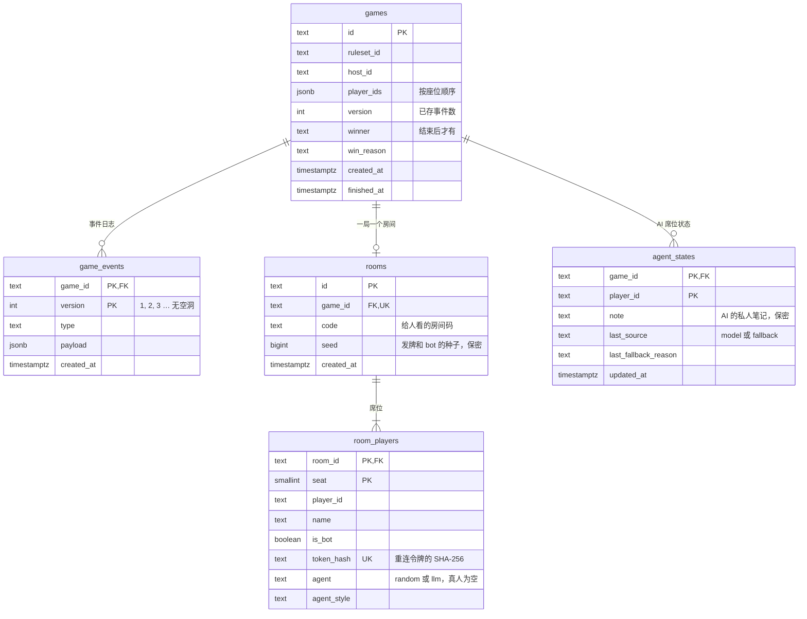

# 数据库

v0.4 起，对局保存在 PostgreSQL。存的是**事件**，不是当前状态：把一局的事件按顺序重放，就得到当前状态。

| 项 | 位置 |
| --- | --- |
| 表定义（代码用） | `apps/api/app/storage/schema.py` |
| 迁移（数据库的真实来源） | `apps/api/migrations/versions/0001_initial_schema.py` |
| 事件 ↔ JSON | `apps/api/app/game/codec.py` |
| 仓库实现 | `apps/api/app/storage/games.py`、`rooms.py` |
| 事务 | `apps/api/app/storage/database.py` |
| 五条查询 | `apps/api/sql/queries.sql` |

## 1. ER 图



`rooms` 另有两列 `gm_mode`（`off` / `template` / `ai`）和 `language`（`zh` / `en`），由迁移 `0002` 加入；`room_players` 多一条约束 `is_bot = (agent IS NOT NULL)`。

迁移 `0001` 在 v0.6 改过一次：CHECK 约束的名字原来被命名规则重复加了前缀（`ck_room_players_ck_room_players_…`），现在用 `op.f()` 固定成 `ck_room_players_…`。这个项目还没有部署过，所以直接改了已发布的迁移；已经用旧版 `0001` 建过的本地库约束照常生效，只是名字是旧的。

## 2. 每张表负责什么

| 表 | 一行是什么 | 关键约束 | 约束挡住的错误 |
| --- | --- | --- | --- |
| `games` | 一局对局 | `version >= 0`；`winner`、`win_reason`、`finished_at` 同有同无 | 结束了却没有胜方 |
| `game_events` | 一个已发生的事件 | 主键 `(game_id, version)`；外键指向 `games` | 同一局出现两个第 N 号事件；事件属于不存在的对局 |
| `rooms` | 对局外面的一层包装 | `game_id` 唯一；外键指向 `games` | 一局对应两个房间；房间指向不存在的对局 |
| `room_players` | 一个席位 | 主键 `(room_id, seat)`；`(room_id, player_id)` 唯一；`token_hash` 唯一；`is_bot = (token_hash IS NULL)`；外键指向 `rooms` | 孤儿玩家；两个席位共用令牌；bot 能登录；真人没有令牌 |

所有外键都是 `ON DELETE CASCADE`：删掉一局，它的事件、房间和席位一起消失。

`games` 不引用 `rooms`，方向是 `rooms → games`。原因：规则引擎只认识对局和玩家 id，房间（昵称、bot、令牌）是应用层的东西，所以对局可以单独存在和测试。

## 3. 写入：一次追加是怎么保证不乱的

`SqlGameRepository.append(game_id, expected_version, events)` 在一个事务里做四步：

| 步骤 | SQL | 失败时 |
| --- | --- | --- |
| 1. 读出对局并重放 | `SELECT` games + game_events | 不存在 → `GameNotFound` |
| 2. 比较版本 | 内存里比较 | 不等 → `VersionConflict` |
| 3. 抢占版本号 | `UPDATE games SET version = :new WHERE id = :id AND version = :expected` | 影响 0 行 → `VersionConflict` |
| 4. 写事件 | `INSERT INTO game_events …` | 主键冲突 → 整个事务回滚 |

- **乐观并发**：第 3 步把“检查版本”和“改版本”放进同一条语句。两个请求都读到版本 N 时，数据库的行锁只放行一个，另一个匹配 0 行。
- **双保险**：即使有代码绕过仓库直接插入，`(game_id, version)` 主键也不允许两个相同版本号。
- **原子性**：创建房间时，`games`、`rooms`、`room_players` 三张表在同一个事务里写入（`GameService` 的 `transaction=`），不会出现只有对局没有房间的情况。
- **API 表现**：`VersionConflict` → HTTP 409 `stale_version`，前端收到后重新拉取对局。

读取时每次都重放全部事件。一局最多一两百个事件，目前足够快；需要时再加快照。

## 4. 五条查询

完整 SQL 在 `apps/api/sql/queries.sql`，`tests/storage/test_queries.py` 会在真实 PostgreSQL 上执行它们，并和引擎算出的结果对比。

### 4.1 房间玩家 `room_players`

```sql
SELECT rp.seat, rp.player_id, rp.name, rp.is_bot
FROM rooms AS r
JOIN room_players AS rp ON rp.room_id = r.id
WHERE r.game_id = :game_id
ORDER BY rp.seat;
```

| 要点 | 说明 |
| --- | --- |
| `JOIN` | 从房间找到它的席位 |
| 走的索引 | `rooms.game_id` 的唯一索引，再走 `room_players` 的主键 `(room_id, seat)` |
| `ORDER BY seat` | 主键已按座位有序，不需要额外排序 |

### 4.2 对局时长 `game_durations`

```sql
SELECT g.id AS game_id, g.winner, g.win_reason,
       g.version AS event_count,
       g.finished_at - g.created_at AS duration
FROM games AS g
WHERE g.finished_at IS NOT NULL
ORDER BY g.finished_at DESC, g.id;
```

| 要点 | 说明 |
| --- | --- |
| 两个时间相减 | PostgreSQL 得到 `interval` 类型 |
| `finished_at IS NOT NULL` | 只看已结束的对局 |
| 为什么把结果抄到 `games` | 不用解析事件 JSON 就能查胜负和时长 |
| 局限 | `created_at` 是建房时间，包含在大厅等待的时间 |

### 4.3 每局任务结果 `mission_results`

```sql
SELECT CAST(e.payload ->> 'mission_number' AS integer) AS mission_number,
       e.payload ->> 'outcome' AS outcome,
       CAST(e.payload ->> 'fail_votes' AS integer) AS fail_votes
FROM game_events AS e
WHERE e.game_id = :game_id AND e.type = 'mission_completed'
ORDER BY mission_number;
```

| 要点 | 说明 |
| --- | --- |
| `->>` | 从 JSONB 里按键取值，结果是文本，所以数字要 `CAST` |
| 过滤 `type` | 一局里只有 3–5 个 `mission_completed` 事件 |
| 走的索引 | 主键 `(game_id, version)` 的前缀 `game_id` |

### 4.4 玩家胜率 `player_win_rates`

思路分三步：

| 步骤 | 做什么 | 用到的语法 |
| --- | --- | --- |
| `dealt` | 把 `game_started` 事件里的 `roles` 数组展开成“每人一行” | `CROSS JOIN LATERAL jsonb_array_elements(...)` |
| `sided` | 角色 → 阵营 | `CASE WHEN role IN ('merlin', 'percival', 'loyal_servant') THEN 'good' ELSE 'evil' END` |
| 最终查询 | 关联席位拿昵称，只统计真人，按昵称汇总 | `count(*) FILTER (WHERE side = winner)`、`GROUP BY` |

| 要点 | 说明 |
| --- | --- |
| `FILTER` | 只数满足条件的行，比 `sum(CASE …)` 清楚 |
| `CAST(... AS numeric)` | 整数相除会丢掉小数，先转成 `numeric` |
| 局限 | 目前没有账号，按昵称汇总；同名的人会被算成同一个 |
| 局限 | 阵营规则在 SQL 里写了一份，新增角色时要和 `rulesets.py` 一起改 |

### 4.5 最近 20 个事件 `recent_events`

```sql
SELECT e.version, e.type, e.payload, e.created_at
FROM game_events AS e
WHERE e.game_id = :game_id
ORDER BY e.version DESC
LIMIT 20;
```

| 要点 | 说明 |
| --- | --- |
| 走的索引 | 主键 `(game_id, version)`，倒着扫 20 行就停 |
| 注意 | 事件里有秘密（角色、每个人出的任务牌），这条查询只能给运维和调试用，不能直接返回给玩家 |

## 5. 怎么运行

| 场景 | 做法 |
| --- | --- |
| Docker Compose | `docker compose up`：API 容器启动时先执行 `alembic upgrade head` |
| 本机，不装数据库 | 不设 `DATABASE_URL`：对局在内存里，重启即丢 |
| 本机，想要重启不丢 | `DATABASE_URL=sqlite:///./avalon.db`，先执行一次 `alembic upgrade head` |
| 本机连 PostgreSQL | `DATABASE_URL=postgresql+psycopg://用户:密码@localhost:5432/avalon` |
| 跑 PostgreSQL 集成测试 | 设 `TEST_DATABASE_URL` 指向一个**可清空**的库；测试会 `TRUNCATE` 所有表 |

SQLite 只是为了本机没有 Docker 时也能持久化和跑测试；行锁并发和 JSONB 查询只在 PostgreSQL 上验证。
